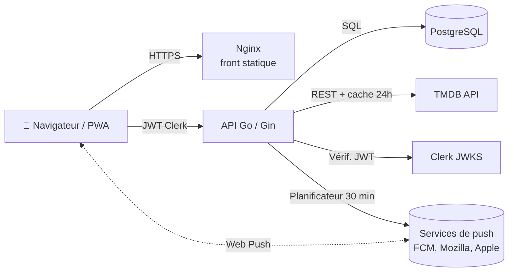

<div align="center">

# 🎬 My TV Time

**Suivi personnel de films et de séries — une PWA moderne, auto-hébergée, pensée pour le mobile.**

Watchlist, épisodes vus, calendrier des sorties, sagas, fiches acteurs, récap annuel façon *Wrapped* et notifications push.

[](https://go.dev/)
[](https://react.dev/)
[](https://www.typescriptlang.org/)
[](https://vite.dev/)
[](https://tailwindcss.com/)
[](https://www.postgresql.org/)
[](https://www.docker.com/)
[](LICENSE)

</div>

---

## 📑 Sommaire

- [Fonctionnalités](#-fonctionnalités)
- [Stack technique](#-stack-technique)
- [Architecture](#-architecture)
- [Structure du projet](#-structure-du-projet)
- [Démarrage rapide (local)](#-démarrage-rapide-local)
- [Variables d'environnement](#-variables-denvironnement)
- [Notifications push](#-notifications-push)
- [Base de données & migrations](#-base-de-données--migrations)
- [API](#-api)
- [Tests & qualité](#-tests--qualité)
- [Déploiement](#-déploiement)
- [Import TV Time](#-import-tv-time)
- [Crédits](#-crédits)
- [Licence](#-licence)

---

## ✨ Fonctionnalités

### 🎞️ Suivi films & séries
- **Watchlist films** : à voir / vu, compteur de revisionnages, coups de cœur, date du premier visionnage.
- **Suivi séries épisode par épisode** : saisons en accordéon, cocher un épisode ou une saison entière, statuts *En cours*, *En attente* (à jour), *À commencer*, *Terminées*.
- **Graphique des notes** par saison et **bandes-annonces** intégrées.
- **Historique** (derniers films / séries vus) et **favoris**.
- **Confirmation** avant toute action destructrice (ne plus suivre une série, retirer un film vu…).

### 🔎 Découverte
- **Recherche multi** (films, séries, personnes) avec onglets paginés.
- **Fiches acteurs / réalisateurs** : biographie (repli en anglais si absente en français), âge, liens IMDb / Instagram, « Connu pour », filmographie filtrable (rôles / équipe technique, films / séries, tri, vus / pas vus) et **progression** (« tu as vu 12 de ses 48 films »).
- **Où regarder** : plateformes disponibles en France (streaming, location, achat) — données JustWatch via TMDB.
- **Sagas automatiques** basées sur les collections TMDB : progression (« 6/8 vus »), prochain film à voir, films à venir, page *Mes sagas*.

### 📅 Calendrier « À venir »
- Prochains épisodes des séries suivies et **sorties françaises** des films de la watchlist (**cinéma** puis **streaming / VOD**).
- Bandeau des 14 prochains jours, section *Sorti récemment* (rattrapage), épisodes d'un même jour regroupés (« Saison complète »).

### 🎉 Wrapped — ton année en revue
- Temps total, films / épisodes / séries, mois par mois, top séries, films marquants, genres, acteurs les plus vus, records (plus gros binge, journée la plus chargée, plus longue série de jours…).
- Détection des **journées de rattrapage** (imports en masse) exclues des records.
- **Image partageable** format story (1080×1920) générée côté navigateur, 4 thèmes, partage natif sur mobile.

### 🔔 Notifications push
- Nouvel épisode d'une série suivie, sortie cinéma ou streaming d'un film de la watchlist.
- Envoyées entre 9h et 22h (heure de Paris), une notification par série, sans doublon.
- Réabonnement silencieux automatique (abonnement expiré, clés changées).

### 📱 PWA
- Installable sur mobile et desktop, mise à jour automatique au retour au premier plan.
- Authentification via **Clerk**.

---

## 🧰 Stack technique

| Couche | Technologies |
| --- | --- |
| **Frontend** | React 19, TypeScript, Vite 8, Tailwind CSS 4, TanStack Query, React Router 7, Recharts, Lucide, `vite-plugin-pwa` (Workbox) |
| **Backend** | Go 1.25, Gin, `lib/pq`, `golang-migrate` (migrations embarquées), `go-cache`, `webpush-go` |
| **Données** | PostgreSQL, API [TMDB](https://www.themoviedb.org/) (métadonnées, crédits, collections, dates de sortie, plateformes) |
| **Auth** | [Clerk](https://clerk.com/) (JWT vérifiés côté API via JWKS) |
| **Infra** | Docker (images API + Nginx), GitHub Actions, GHCR, VPS |

---

## 🏗️ Architecture



- **Le front** est une SPA servie par Nginx ; le service worker met l'app en cache et reçoit les notifications.
- **L'API** est un *BFF* : elle combine les données TMDB (mises en cache 24h en mémoire) et l'état de l'utilisateur stocké en base (statuts, épisodes vus, favoris…).
- **Le planificateur de notifications** tourne dans le même processus que l'API — aucun service supplémentaire à déployer.

---

## 📂 Structure du projet

```text
my-tvtime/
├── .github/workflows/deploy.yml   # CI/CD : build des images + déploiement sur le VPS
├── backend/
│   ├── cmd/
│   │   ├── api/                   # Point d'entrée de l'API (routes, configuration)
│   │   └── seeder/                # Outil de synchronisation des métadonnées TMDB
│   ├── database/
│   │   └── migrations/            # Migrations SQL (appliquées au démarrage)
│   ├── internal/
│   │   ├── calendar/              # Calendrier des sorties (épisodes + films, dates FR)
│   │   ├── importservice/         # Import TV Time
│   │   ├── middleware/            # Authentification Clerk
│   │   ├── movie/  tv/            # Suivi films / séries
│   │   ├── notification/          # Web push + planificateur
│   │   ├── person/                # Fiches acteurs / réalisateurs
│   │   ├── providers/             # « Où regarder »
│   │   ├── saga/                  # Sagas (collections TMDB)
│   │   ├── search/                # Recherche
│   │   ├── tmdb/                  # Client TMDB (avec cache)
│   │   └── user/                  # Profil, stats, historique, Wrapped
│   └── Dockerfile.api
└── frontend/
    ├── public/push-sw.js          # Réception des notifications (importé dans le service worker)
    ├── src/
    │   ├── api/                   # Clients HTTP typés
    │   ├── components/            # Composants partagés (cartes, calendrier, dialogues…)
    │   ├── features/              # Pages : movie, tv, person, saga, wrapped, profile, search, watchlist
    │   ├── hooks/  utils/         # Hooks et utilitaires (push, haptique, formatage…)
    │   └── pwa.ts                 # Enregistrement du service worker et mises à jour
    ├── nginx.conf
    └── Dockerfile.frontend
```

---

## 🚀 Démarrage rapide (local)

### Prérequis

- [Go](https://go.dev/dl/) **1.25+**
- [Node.js](https://nodejs.org/) **24+** et npm
- [Docker](https://www.docker.com/) (pour PostgreSQL)
- Une **clé API TMDB** — [gratuite](https://www.themoviedb.org/settings/api)
- Une application **Clerk** — clé publique + URL JWKS

### 1. Base de données

```bash
docker run -d --name my_tvtime_db \
  -e POSTGRES_USER=mytvtime \
  -e POSTGRES_PASSWORD=change_me \
  -e POSTGRES_DB=mytvtime_db \
  -p 5432:5432 \
  -v mytvtime_pgdata:/var/lib/postgresql/data \
  postgres:16-alpine
```

> Les tables sont créées automatiquement au démarrage de l'API (migrations embarquées).

### 2. API (Go)

```bash
cd backend
export DB_HOST=localhost DB_USER=mytvtime DB_PASSWORD=change_me DB_NAME=mytvtime_db
export API_PORT=8080 FRONTEND_URL=http://localhost:3000
export TMDB_API_KEY=ta_cle_tmdb
export CLERK_JWKS_URL=https://<ton-instance>.clerk.accounts.dev/.well-known/jwks.json
go run ./cmd/api
```

<details>
<summary>Équivalent PowerShell (Windows)</summary>

```powershell
$env:DB_HOST="localhost"; $env:DB_USER="mytvtime"; $env:DB_PASSWORD="change_me"; $env:DB_NAME="mytvtime_db"
$env:API_PORT="8080"; $env:FRONTEND_URL="http://localhost:3000"
$env:TMDB_API_KEY="ta_cle_tmdb"
$env:CLERK_JWKS_URL="https://<ton-instance>.clerk.accounts.dev/.well-known/jwks.json"
go run ./cmd/api
```
</details>

Vérification : `curl http://localhost:8080/health` → `{"status":"UP"}`

### 3. Frontend (React)

Crée `frontend/.env` :

```env
VITE_API_URL=http://localhost:8080/api/v1
VITE_CLERK_PUBLISHABLE_KEY=pk_test_xxxxxxxxxxxx
```

Puis :

```bash
cd frontend
npm install
npm run dev
```

L'app est disponible sur **http://localhost:3000**.

> 💡 Le service worker (cache PWA, notifications) n'est actif qu'en build de production : `npm run build && npm run preview`.

---

## 🔐 Variables d'environnement

### API (`backend`)

| Variable | Obligatoire | Défaut | Description |
| --- | :---: | --- | --- |
| `DB_HOST` | ✅ | `localhost` | Hôte PostgreSQL |
| `DB_USER` | ✅ | — | Utilisateur PostgreSQL |
| `DB_PASSWORD` | ✅ | — | Mot de passe PostgreSQL |
| `DB_NAME` | | `mytvtime_db` | Nom de la base |
| `API_PORT` | | `8080` | Port d'écoute de l'API |
| `FRONTEND_URL` | ✅ | `http://localhost:3000` | Origine autorisée (CORS) |
| `TMDB_API_KEY` | ✅ | — | Clé API TMDB |
| `CLERK_JWKS_URL` | ✅ | — | URL JWKS de Clerk pour vérifier les jetons |
| `VAPID_PUBLIC_KEY` | | — | Clé publique Web Push (notifications désactivées si absente) |
| `VAPID_PRIVATE_KEY` | | — | Clé privée Web Push |
| `VAPID_SUBJECT` | | `FRONTEND_URL` | Contact VAPID (`mailto:` ou URL `https://`) |
| `GIN_MODE` | | — | `release` en production |

### Frontend (`frontend/.env`, injectées au build)

| Variable | Description |
| --- | --- |
| `VITE_API_URL` | URL de l'API, **avec** `/api/v1` |
| `VITE_CLERK_PUBLISHABLE_KEY` | Clé publique Clerk |

> ⚠️ Ne commite jamais de secrets : `.env` et les fichiers de configuration locale sont ignorés par git.

---

## 🔔 Notifications push

Les notifications utilisent le standard **Web Push** avec une paire de clés **VAPID**.

1. **Générer les clés** (une seule fois) :
   ```bash
   npx web-push generate-vapid-keys
   ```
2. Les fournir à l'API via `VAPID_PUBLIC_KEY` / `VAPID_PRIVATE_KEY` (en prod : secrets GitHub du même nom).
3. Dans l'app : **Profil → ⚙️ Réglages → Notifications**, puis « Envoyer une notification de test ».

**Bon à savoir**
- 🔑 **Garde toujours les mêmes clés.** En cas de changement, les appareils se réabonnent automatiquement à la prochaine ouverture de l'app.
- 🍎 **iPhone / iPad** : l'app doit être **installée sur l'écran d'accueil** (iOS 16.4+).
- 🔒 HTTPS obligatoire (sauf `localhost`).
- Sans clés VAPID, l'option n'apparaît simplement pas : le reste de l'app fonctionne normalement.

---

## 🗄️ Base de données & migrations

Les migrations SQL (`backend/database/migrations`) sont **embarquées dans le binaire** et appliquées automatiquement au démarrage avec `golang-migrate`.

| Migration | Contenu |
| --- | --- |
| `000001_init_schema` | Utilisateurs, films suivis |
| `000002_add_tv_schema` | Séries suivies, épisodes vus |
| `000003_add_metadata_tables` | Métadonnées films / épisodes (durées, dates) |
| `000004_add_push_tables` | Abonnements push, notifications envoyées |

Pour ajouter une migration : créer `00000N_description.up.sql` et `.down.sql` dans ce dossier.

### Synchronisation des métadonnées

L'outil `backend/cmd/seeder` met à jour titres, dates de sortie et durées depuis TMDB (utile après un import). Voir [`backend/cmd/seeder/seeder.md`](backend/cmd/seeder/seeder.md).
La mise en place de PostgreSQL sur le VPS est décrite dans [`backend/database/README.md`](backend/database/README.md).

---

## 📡 API

Toutes les routes sont préfixées par `/api/v1` et nécessitent un JWT Clerk (`Authorization: Bearer <token>`), sauf `/health`.

<details>
<summary><strong>Voir toutes les routes</strong></summary>

#### Films
| Méthode | Route | Description |
| --- | --- | --- |
| `GET` | `/movies/:id` | Détails d'un film + statut utilisateur |
| `POST` | `/movies/status` | Ajouter / mettre à jour (à voir, vu, favori, revisionnages) |
| `DELETE` | `/movies/:id` | Retirer un film |
| `GET` | `/movies/watchlist` | Watchlist paginée |
| `GET` | `/movies/favorites` | Films favoris |
| `GET` | `/movies/upcoming` | Films à venir de la watchlist |
| `GET` | `/movies/:id/similar` | Films similaires |
| `GET` | `/movies/:id/credits` | Casting et équipe |
| `GET` | `/movies/:id/providers` | Où regarder (`?region=FR`) |

#### Séries
| Méthode | Route | Description |
| --- | --- | --- |
| `GET` | `/tvs/:id` | Détails d'une série + progression |
| `POST` | `/tvs/status` | Suivre / mettre à jour une série |
| `DELETE` | `/tvs/:id` | Ne plus suivre (supprime les épisodes vus) |
| `GET` | `/tvs/watchlist` · `/tvs/favorites` · `/tvs/upcoming` | Listes |
| `GET` | `/tvs/:id/similar` · `/tvs/:id/credits` · `/tvs/:id/providers` | Infos complémentaires |
| `GET` | `/tvs/:id/season/:season` | Épisodes d'une saison + statut vu |
| `POST` | `/tvs/watch` | Marquer un épisode vu |
| `POST` | `/tvs/watchAll` | Marquer une saison vue |
| `PUT` | `/tvs/:id/season/:season/episode/:episode/decrement` | Retirer un revisionnage |
| `DELETE` | `/tvs/:id/season/:season/episode/:episode` | Retirer un épisode vu |

#### Découverte
| Méthode | Route | Description |
| --- | --- | --- |
| `GET` | `/search/multi?q=` | Recherche films, séries, personnes |
| `GET` | `/search/:type?q=&page=` | Recherche paginée (`movie`, `tv`, `person`) |
| `GET` | `/persons/:id` | Fiche personne + filmographie enrichie |
| `GET` | `/sagas/:id` | Saga (collection TMDB) + progression |

#### Utilisateur
| Méthode | Route | Description |
| --- | --- | --- |
| `GET` | `/user/stats` | Statistiques globales |
| `GET` | `/user/movies/latest` · `/user/tvs/latest` | Historique récent |
| `GET` | `/user/calendar?type=&days=` | Calendrier des sorties |
| `GET` | `/user/sagas` | Sagas de l'utilisateur |
| `GET` | `/user/wrapped?year=` | Récap annuel |

#### Notifications
| Méthode | Route | Description |
| --- | --- | --- |
| `GET` | `/push/config` | Clé publique VAPID + état |
| `POST` | `/push/subscribe` | Enregistrer un appareil |
| `POST` | `/push/unsubscribe` | Désinscrire un appareil |
| `POST` | `/push/test` | Envoyer une notification de test |

#### Import
| Méthode | Route | Description |
| --- | --- | --- |
| `POST` | `/import/tvtime/upload` | Analyse d'un export TV Time |
| `GET` | `/import/tvtime/status/:taskID` | Progression de l'analyse |
| `POST` | `/import/tvtime/confirm` | Confirmer l'import |

</details>

---

## 🧪 Tests & qualité

```bash
# Backend : tests unitaires
cd backend && go test ./...

# Frontend : typage + lint + build de production
cd frontend
npx tsc -b
npm run lint
npm run build
```

Les tests couvrent notamment la détection des journées de rattrapage du Wrapped, le calcul des séries de jours, le choix des dates de sortie françaises et le contenu des notifications.

---

## 🚢 Déploiement

Le déploiement est **entièrement automatisé** par GitHub Actions ([`.github/workflows/deploy.yml`](.github/workflows/deploy.yml)) à chaque push sur `main` :

1. **Build** des images Docker `api` et `web`, poussées sur **GHCR**.
2. **Déploiement SSH** sur le VPS : pull des images, remplacement des conteneurs dans le réseau Docker `my_tvtime_network`.

| Conteneur | Port interne → public |
| --- | --- |
| `my-tvtime-api` | `8080 → 5016` |
| `my-tvtime-web` (Nginx) | `80 → 5017` |
| `my_tvtime_db` (PostgreSQL) | non exposé |

### Secrets GitHub requis

| Secret | Utilisation |
| --- | --- |
| `VPS_HOST`, `VPS_USERNAME`, `VPS_PASSWORD` | Connexion SSH au VPS |
| `DB_PROD_USER`, `DB_PROD_PASSWORD` | Accès PostgreSQL |
| `TMDB_API_KEY` | API TMDB |
| `CLERK_JWKS_URL` | Vérification des jetons Clerk |
| `FRONTEND_PROD_URL` | Origine CORS autorisée |
| `VITE_PROD_API_URL`, `VITE_CLERK_PUBLISHABLE_KEY` | Variables du build front |
| `VAPID_PUBLIC_KEY`, `VAPID_PRIVATE_KEY` | Notifications push (optionnel) |

> Nginx sert le service worker sans cache (`sw.js`, `push-sw.js`…) pour que les mises à jour de la PWA arrivent immédiatement ; les assets versionnés sont, eux, mis en cache un an.

---

## 📥 Import TV Time

Tu peux récupérer tout ton historique depuis **TV Time** :

1. Demande l'export de tes données à TV Time (archive `.zip`).
2. Dans l'app : **Profil → ⚙️ Réglages → Importer depuis TV Time**.
3. Vérifie l'analyse (films et séries reconnus), puis confirme.

Les fichiers `user_tv_show_data.csv` et `tracking-prod-records(-v2).csv` de l'archive sont pris en charge.

---

## 🙏 Crédits

Métadonnées, images et crédits fournis par [**The Movie Database (TMDB)**](https://www.themoviedb.org/).
Ce produit utilise l'API TMDB mais n'est ni approuvé ni certifié par TMDB.
Les données « Où regarder » sont fournies par **JustWatch** via TMDB.

---

## 📄 Licence

Distribué sous licence **GNU Affero General Public License v3.0** — voir [`LICENSE`](LICENSE).
