<div align="center">

# 🎬 My TV Time

**Personal movie and TV show tracker — a modern, self-hosted, mobile-first PWA.**

Watchlist, watched episodes, release calendar, sagas, cast pages, a *Wrapped*-style yearly recap and push notifications.

[](https://go.dev/)
[](https://react.dev/)
[](https://www.typescriptlang.org/)
[](https://vite.dev/)
[](https://tailwindcss.com/)
[](https://www.postgresql.org/)
[](https://www.docker.com/)
[](LICENSE)

<br />

<table>
  <tr>
    <td align="center">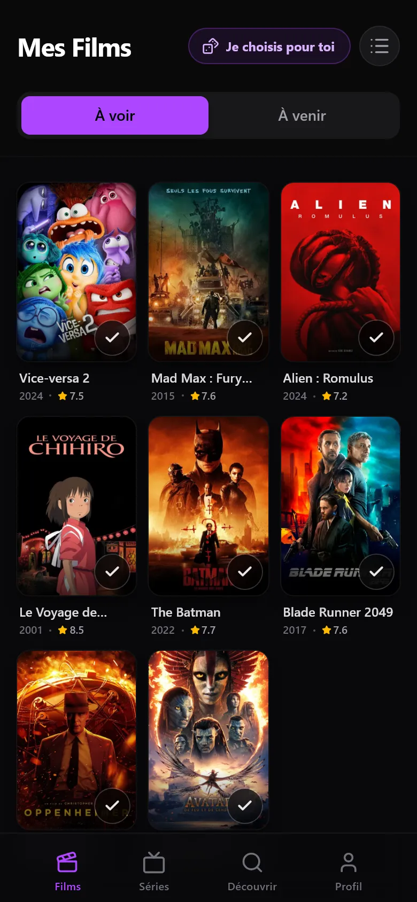<br /><sub><b>Watchlist</b></sub></td>
    <td align="center">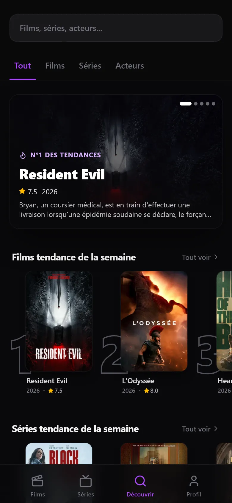<br /><sub><b>Discover</b></sub></td>
    <td align="center">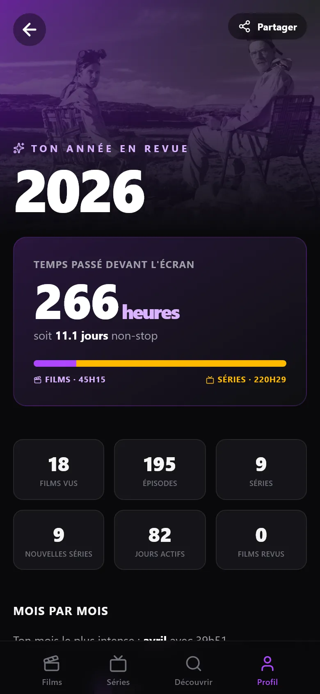<br /><sub><b>Wrapped</b></sub></td>
  </tr>
</table>

</div>

---

## 📑 Table of contents

- [Screenshots](#-screenshots)
- [Features](#-features)
- [Tech stack](#-tech-stack)
- [Architecture](#-architecture)
- [Project structure](#-project-structure)
- [Quick start (local)](#-quick-start-local)
- [Environment variables](#-environment-variables)
- [Push notifications](#-push-notifications)
- [Database & migrations](#-database--migrations)
- [API](#-api)
- [Tests & quality](#-tests--quality)
- [Deployment](#-deployment)
- [TV Time import](#-tv-time-import)
- [Credits](#-credits)
- [License](#-license)

---

## 📸 Screenshots

<table>
  <tr>
    <td align="center">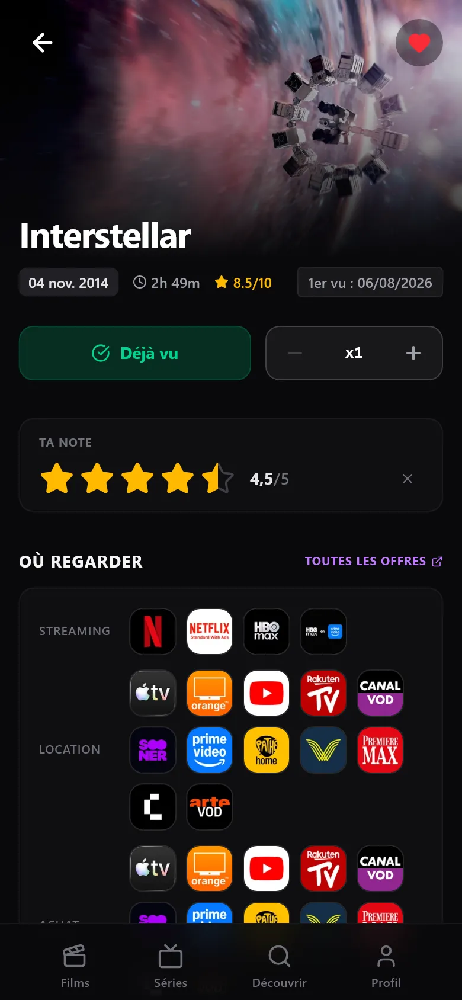<br /><sub><b>Movie page &amp; where to watch</b></sub></td>
    <td align="center">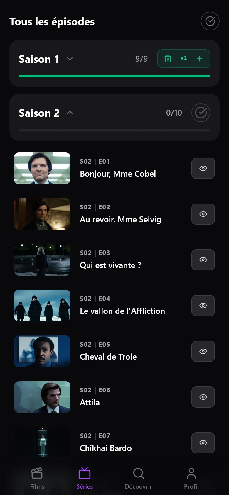<br /><sub><b>Episode tracking</b></sub></td>
    <td align="center">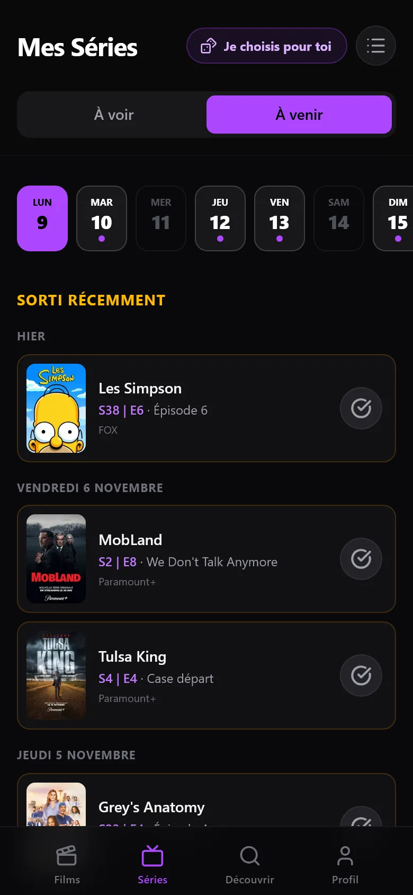<br /><sub><b>Release calendar</b></sub></td>
    <td align="center">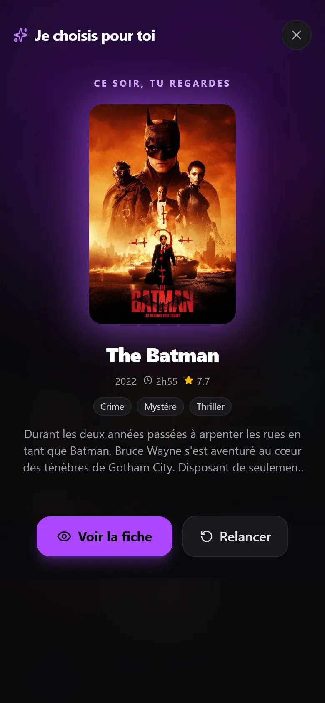<br /><sub><b>“Pick for me”</b></sub></td>
  </tr>
  <tr>
    <td align="center">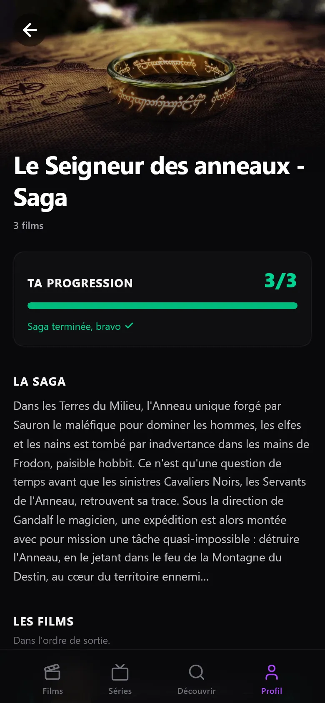<br /><sub><b>Sagas</b></sub></td>
    <td align="center">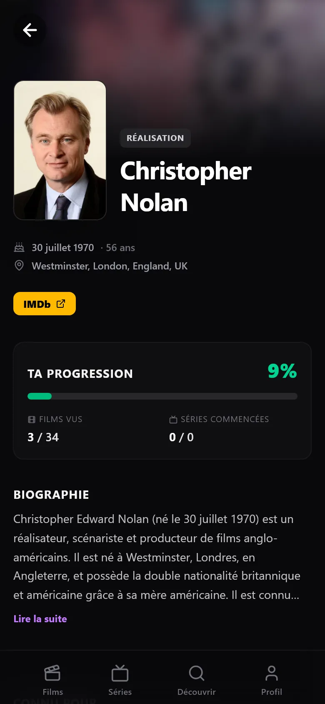<br /><sub><b>Cast &amp; crew pages</b></sub></td>
    <td align="center">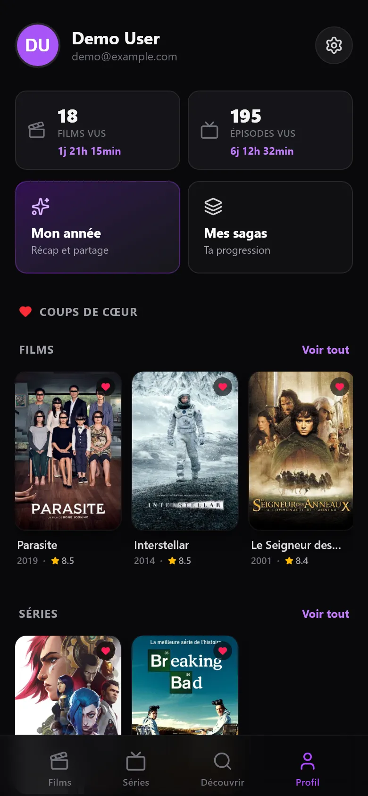<br /><sub><b>Profile &amp; stats</b></sub></td>
    <td></td>
  </tr>
</table>

> The interface is in French and release data targets France. Screenshots show a demo account.

---

## ✨ Features

### 🎞️ Movie & TV tracking
- **Movie watchlist**: to watch / watched, rewatch counter, favorites, first-watched date.
- **Episode-by-episode TV tracking**: season accordions, mark one episode or a whole season, with *Watching*, *Up to date*, *Not started* and *Finished* statuses.
- **Personal ratings** in half stars, a **per-season ratings chart** and embedded **trailers**.
- **History** (latest movies and shows watched) and **favorites**.
- **Undo toast** after marking something as watched, and a **confirmation** before any destructive action (unfollowing a show, removing a watched movie…).

### 🔎 Discovery
- **Discover page** with weekly trending movies and shows.
- **“Pick for me”** draws a title from your watchlist, with duration and genre filters.
- **Multi-search** (movies, shows, people) with paginated tabs.
- **Cast & crew pages**: biography (English fallback when no French version exists), age, IMDb / Instagram links, “Known for”, a filterable filmography (acting / crew, movies / shows, sorting, watched / unwatched) and **progress** (“you've seen 12 of their 48 movies”).
- **Where to watch**: services available in France (streaming, rental, purchase) using JustWatch data via TMDB, plus **“My platforms”** to select the services you subscribe to.
- **Automatic sagas** based on TMDB collections: progress (“6/8 watched”), next movie to watch, upcoming movies and a *My sagas* page.

### 📅 “Upcoming” calendar
- Next episodes of followed shows and **French releases** of watchlist movies (**theaters**, then **streaming / VOD**).
- A 14-day strip, a *Recently released* catch-up section, and same-day episodes grouped together (“Full season”).

### 🎉 Wrapped — your year in review
- Total time, movies / episodes / shows, month-by-month view, top shows, standout movies, genres, most-watched actors and records (biggest binge, busiest day, longest streak…).
- **Catch-up days** (bulk imports) are detected and excluded from records.
- **Shareable story image** (1080×1920) generated in the browser, with 4 themes and native sharing on mobile.

### 🔔 Push notifications
- Watchlist movies: always notified on their first release in France (theaters, or streaming / VOD for a direct-to-platform movie). VOD availability of a movie that already played in theaters is not notified.
- Shows: off by default, enabled per show with the 🔔 bell on its page.
- Sent between 9 AM and 10 PM (Paris time), one notification per show, without duplicates.
- Automatic silent resubscription (expired subscription, rotated keys).

### 📱 PWA
- Installable on mobile and desktop, with automatic updates when the app returns to the foreground.
- **Offline mode**: cached data stays available and actions made offline are replayed when the network returns.
- Authentication via **Clerk**.

---

## 🧰 Tech stack

| Layer | Technologies |
| --- | --- |
| **Frontend** | React 19, TypeScript, Vite 8, Tailwind CSS 4, TanStack Query, React Router 7, Recharts, Lucide, `vite-plugin-pwa` (Workbox) |
| **Backend** | Go 1.25, Gin, `lib/pq`, `golang-migrate` (embedded migrations), `go-cache`, `webpush-go` |
| **Data** | PostgreSQL, [TMDB](https://www.themoviedb.org/) API (metadata, credits, collections, release dates, streaming services) |
| **Auth** | [Clerk](https://clerk.com/) (JWTs verified by the API through JWKS) |
| **Infra** | Docker (API + Nginx images), GitHub Actions, GHCR, VPS |

---

## 🏗️ Architecture

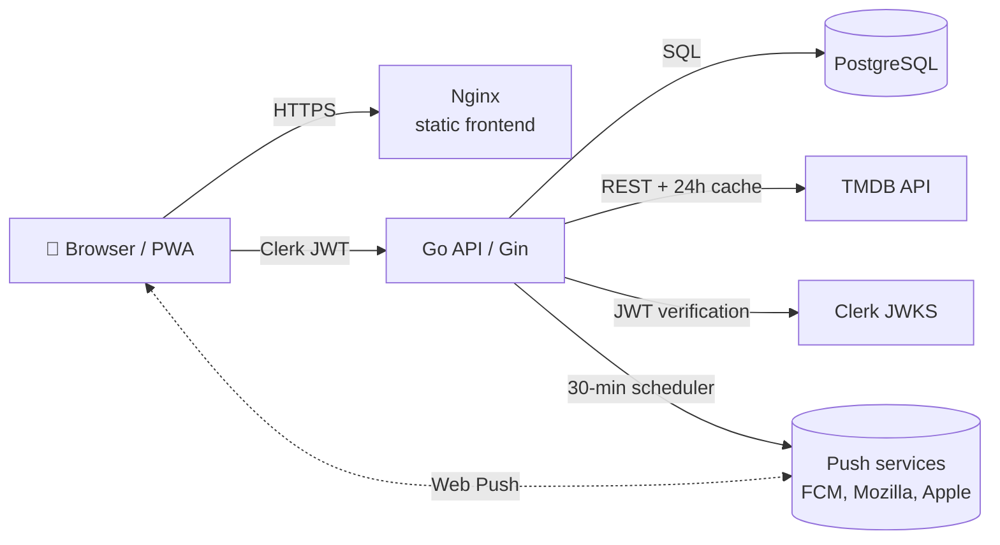

- **The frontend** is an SPA served by Nginx; the service worker caches the app and receives notifications.
- **The API** is a *BFF*: it combines TMDB data (cached in memory for 24 hours) with user state stored in the database (statuses, watched episodes, favorites…).
- **The notification scheduler** runs in the same process as the API, so there is no extra service to deploy.

---

## 📂 Project structure

```text
my-tvtime/
├── .github/workflows/deploy.yml   # CI/CD: builds images and deploys to the VPS
├── backend/
│   ├── cmd/
│   │   ├── api/                   # API entry point (routes, configuration)
│   │   └── seeder/                # TMDB metadata sync tool
│   ├── database/
│   │   └── migrations/            # SQL migrations (applied at startup)
│   ├── internal/
│   │   ├── calendar/              # Release calendar (episodes + movies, French dates)
│   │   ├── discover/              # Trending lists
│   │   ├── importservice/         # TV Time import
│   │   ├── middleware/            # Clerk authentication
│   │   ├── movie/  tv/            # Movie / show tracking
│   │   ├── notification/          # Web push + scheduler
│   │   ├── person/                # Cast & crew pages
│   │   ├── providers/             # “Where to watch” and user platforms
│   │   ├── saga/                  # Sagas (TMDB collections)
│   │   ├── search/                # Search
│   │   ├── tmdb/                  # TMDB client (with cache)
│   │   └── user/                  # Profile, stats, history, Wrapped
│   └── Dockerfile.api
├── docs/screenshots/              # Images used in this README
└── frontend/
    ├── public/push-sw.js          # Notification handling (imported by the service worker)
    ├── src/
    │   ├── api/                   # Typed HTTP clients
    │   ├── components/            # Shared components (cards, calendar, dialogs…)
    │   ├── features/              # Pages: discover, movie, tv, person, saga, wrapped, profile, search, watchlist
    │   ├── hooks/  utils/         # Hooks and utilities (push, haptics, formatting…)
    │   ├── offline/               # Offline session, cache persistence, queued actions
    │   └── pwa.ts                 # Service worker registration and updates
    ├── nginx.conf
    └── Dockerfile.frontend
```

---

## 🚀 Quick start (local)

### Prerequisites

- [Go](https://go.dev/dl/) **1.25+**
- [Node.js](https://nodejs.org/) **24+** and npm
- [Docker](https://www.docker.com/) (for PostgreSQL)
- A **TMDB API key** — [free](https://www.themoviedb.org/settings/api)
- A **Clerk** application — publishable key + JWKS URL

### 1. Database

```bash
docker run -d --name my_tvtime_db \
  -e POSTGRES_USER=mytvtime \
  -e POSTGRES_PASSWORD=change_me \
  -e POSTGRES_DB=mytvtime_db \
  -p 5432:5432 \
  -v mytvtime_pgdata:/var/lib/postgresql/data \
  postgres:16-alpine
```

> Tables are created automatically when the API starts (embedded migrations).

### 2. API (Go)

```bash
cd backend
export DB_HOST=localhost DB_USER=mytvtime DB_PASSWORD=change_me DB_NAME=mytvtime_db
export API_PORT=8080 FRONTEND_URL=http://localhost:3000
export TMDB_API_KEY=your_tmdb_key
export CLERK_JWKS_URL=https://<your-instance>.clerk.accounts.dev/.well-known/jwks.json
go run ./cmd/api
```

<details>
<summary>PowerShell equivalent (Windows)</summary>

```powershell
$env:DB_HOST="localhost"; $env:DB_USER="mytvtime"; $env:DB_PASSWORD="change_me"; $env:DB_NAME="mytvtime_db"
$env:API_PORT="8080"; $env:FRONTEND_URL="http://localhost:3000"
$env:TMDB_API_KEY="your_tmdb_key"
$env:CLERK_JWKS_URL="https://<your-instance>.clerk.accounts.dev/.well-known/jwks.json"
go run ./cmd/api
```
</details>

Check it: `curl http://localhost:8080/health` → `{"status":"UP"}`

### 3. Frontend (React)

Create `frontend/.env`:

```env
VITE_API_URL=http://localhost:8080/api/v1
VITE_CLERK_PUBLISHABLE_KEY=pk_test_xxxxxxxxxxxx
```

Then:

```bash
cd frontend
npm install
npm run dev
```

The app is available at **http://localhost:3000**.

> 💡 The service worker (PWA cache, notifications) is only active in production builds: `npm run build && npm run preview`.

---

## 🔐 Environment variables

### API (`backend`)

| Variable | Required | Default | Description |
| --- | :---: | --- | --- |
| `DB_HOST` | ✅ | `localhost` | PostgreSQL host |
| `DB_USER` | ✅ | — | PostgreSQL user |
| `DB_PASSWORD` | ✅ | — | PostgreSQL password |
| `DB_NAME` | | `mytvtime_db` | Database name |
| `API_PORT` | | `8080` | API listening port |
| `FRONTEND_URL` | ✅ | `http://localhost:3000` | Allowed origin (CORS) |
| `TMDB_API_KEY` | ✅ | — | TMDB API key |
| `CLERK_JWKS_URL` | ✅ | — | Clerk JWKS URL used to verify tokens |
| `VAPID_PUBLIC_KEY` | | — | Web Push public key (notifications are disabled without it) |
| `VAPID_PRIVATE_KEY` | | — | Web Push private key |
| `VAPID_SUBJECT` | | `FRONTEND_URL` | VAPID contact (`mailto:` or `https://` URL) |
| `GIN_MODE` | | — | `release` in production |

### Frontend (`frontend/.env`, injected at build time)

| Variable | Description |
| --- | --- |
| `VITE_API_URL` | API URL, **including** `/api/v1` |
| `VITE_CLERK_PUBLISHABLE_KEY` | Clerk publishable key |

> ⚠️ Never commit secrets: `.env` and local configuration files are ignored by git.

---

## 🔔 Push notifications

Notifications use the **Web Push** standard with a **VAPID** key pair.

1. **Generate the keys** (once):
   ```bash
   npx web-push generate-vapid-keys
   ```
2. Pass them to the API through `VAPID_PUBLIC_KEY` / `VAPID_PRIVATE_KEY` (in production: GitHub secrets with the same names).
3. In the app, go to **Profile → ⚙️ Settings → Notifications**, then send a test notification.

**Good to know**
- 🔑 **Always keep the same keys.** If they change, devices resubscribe automatically the next time the app is opened.
- 🍎 **iPhone / iPad**: the app must be **installed on the home screen** (iOS 16.4+).
- 🔒 HTTPS is required (except on `localhost`).
- Without VAPID keys, the option simply doesn't appear and the rest of the app works normally.

---

## 🗄️ Database & migrations

SQL migrations (`backend/database/migrations`) are **embedded in the binary** and applied automatically at startup with `golang-migrate`.

| Migration | Contents |
| --- | --- |
| `000001_init_schema` | Users, tracked movies |
| `000002_add_tv_schema` | Tracked shows, watched episodes |
| `000003_add_metadata_tables` | Movie / episode metadata (runtimes, dates) |
| `000004_add_push_tables` | Push subscriptions, sent notifications |
| `000005_add_series_notifications` | Per-show notification bell (off by default) |
| `000006_add_ratings_and_platforms` | Personal ratings, user streaming platforms |

To add a migration, create `00000N_description.up.sql` and `.down.sql` in that folder.

### Metadata sync

The `backend/cmd/seeder` tool updates titles, release dates and runtimes from TMDB (useful after an import). See [`backend/cmd/seeder/seeder.md`](backend/cmd/seeder/seeder.md).
PostgreSQL setup on the VPS is described in [`backend/database/README.md`](backend/database/README.md).

---

## 📡 API

All routes are prefixed with `/api/v1` and require a Clerk JWT (`Authorization: Bearer <token>`), except `/health`.

<details>
<summary><strong>View all routes</strong></summary>

#### Movies
| Method | Route | Description |
| --- | --- | --- |
| `GET` | `/movies/:id` | Movie details + user status |
| `POST` | `/movies/status` | Add / update (to watch, watched, favorite, rewatches) |
| `DELETE` | `/movies/:id` | Remove a movie |
| `PUT` | `/movies/:id/rating` | Set or clear the personal rating (`{ "rating": 1..10 \| null }`) |
| `GET` | `/movies/watchlist` | Paginated watchlist |
| `GET` | `/movies/favorites` | Favorite movies |
| `GET` | `/movies/upcoming` | Upcoming watchlist movies |
| `GET` | `/movies/:id/similar` | Similar movies |
| `GET` | `/movies/:id/credits` | Cast and crew |
| `GET` | `/movies/:id/providers` | Where to watch (`?region=FR`) |

#### TV shows
| Method | Route | Description |
| --- | --- | --- |
| `GET` | `/tvs/:id` | Show details + progress |
| `POST` | `/tvs/status` | Follow / update a show |
| `DELETE` | `/tvs/:id` | Unfollow (deletes watched episodes) |
| `PUT` | `/tvs/:id/rating` | Set or clear the personal rating (`{ "rating": 1..10 \| null }`) |
| `PUT` | `/tvs/:id/notifications` | Enable / disable new-episode notifications (`{ "enabled": bool }`) |
| `GET` | `/tvs/watchlist` · `/tvs/favorites` · `/tvs/upcoming` | Lists |
| `GET` | `/tvs/:id/similar` · `/tvs/:id/credits` · `/tvs/:id/providers` | Additional info |
| `GET` | `/tvs/:id/season/:season` | Season episodes + watched status |
| `POST` | `/tvs/watch` | Mark an episode as watched |
| `POST` | `/tvs/watchAll` | Mark a season as watched |
| `PUT` | `/tvs/:id/season/:season/episode/:episode/decrement` | Remove a rewatch |
| `DELETE` | `/tvs/:id/season/:season/episode/:episode` | Remove a watched episode |

#### Discovery
| Method | Route | Description |
| --- | --- | --- |
| `GET` | `/search/multi?q=` | Search movies, shows, people |
| `GET` | `/search/:type?q=&page=` | Paginated search (`movie`, `tv`, `person`) |
| `GET` | `/discover/:type/:list` | Discovery lists (trending…) |
| `GET` | `/persons/:id` | Person page + enriched filmography |
| `GET` | `/sagas/:id` | Saga (TMDB collection) + progress |
| `GET` | `/providers/catalog` | Available streaming services |

#### User
| Method | Route | Description |
| --- | --- | --- |
| `GET` | `/user/stats` | Global statistics |
| `GET` | `/user/movies/latest` · `/user/tvs/latest` | Recent history |
| `GET` | `/user/calendar?type=&days=` | Release calendar |
| `GET` | `/user/sagas` | User's sagas |
| `GET` | `/user/wrapped?year=` | Yearly recap |
| `GET` · `PUT` | `/user/providers` | Read / update the user's platforms |

#### Notifications
| Method | Route | Description |
| --- | --- | --- |
| `GET` | `/push/config` | VAPID public key + state |
| `POST` | `/push/subscribe` | Register a device |
| `POST` | `/push/unsubscribe` | Unregister a device |
| `POST` | `/push/test` | Send a test notification |

#### Import
| Method | Route | Description |
| --- | --- | --- |
| `POST` | `/import/tvtime/upload` | Analyze a TV Time export |
| `GET` | `/import/tvtime/status/:taskID` | Analysis progress |
| `POST` | `/import/tvtime/confirm` | Confirm the import |

</details>

---

## 🧪 Tests & quality

```bash
# Backend: unit tests
cd backend && go test ./...

# Frontend: type-check + lint + production build
cd frontend
npx tsc -b
npm run lint
npm run build
```

Tests notably cover Wrapped catch-up day detection, streak calculation, French release date selection and notification content.

---

## 🚢 Deployment

Deployment is **fully automated** by GitHub Actions ([`.github/workflows/deploy.yml`](.github/workflows/deploy.yml)) on every push to `main`:

1. **Build** the `api` and `web` Docker images and push them to **GHCR**.
2. **SSH deployment** to the VPS: pull the images and replace the containers on the `my_tvtime_network` Docker network.

| Container | Internal → public port |
| --- | --- |
| `my-tvtime-api` | `8080 → 5016` |
| `my-tvtime-web` (Nginx) | `80 → 5017` |
| `my_tvtime_db` (PostgreSQL) | not exposed |

### Required GitHub secrets

| Secret | Usage |
| --- | --- |
| `VPS_HOST`, `VPS_USERNAME`, `VPS_PASSWORD` | SSH connection to the VPS |
| `DB_PROD_USER`, `DB_PROD_PASSWORD` | PostgreSQL access |
| `TMDB_API_KEY` | TMDB API |
| `CLERK_JWKS_URL` | Clerk token verification |
| `FRONTEND_PROD_URL` | Allowed CORS origin |
| `VITE_PROD_API_URL`, `VITE_CLERK_PUBLISHABLE_KEY` | Frontend build variables |
| `VAPID_PUBLIC_KEY`, `VAPID_PRIVATE_KEY` | Push notifications (optional) |

> Nginx serves the service worker uncached (`sw.js`, `push-sw.js`…) so PWA updates arrive immediately; versioned assets are cached for one year.

---

## 📥 TV Time import

You can bring over your full history from **TV Time**:

1. Request your data export from TV Time (`.zip` archive).
2. In the app, go to **Profile → ⚙️ Settings → Import from TV Time**.
3. Review the analysis (recognized movies and shows), then confirm.

The archive's `user_tv_show_data.csv` and `tracking-prod-records(-v2).csv` files are supported.

---

## 🙏 Credits

Metadata, images and credits are provided by [**The Movie Database (TMDB)**](https://www.themoviedb.org/).
This product uses the TMDB API but is not endorsed or certified by TMDB.
“Where to watch” data is provided by **JustWatch** via TMDB.

---

## 📄 License

Distributed under the **GNU Affero General Public License v3.0** — see [`LICENSE`](LICENSE).
